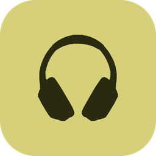
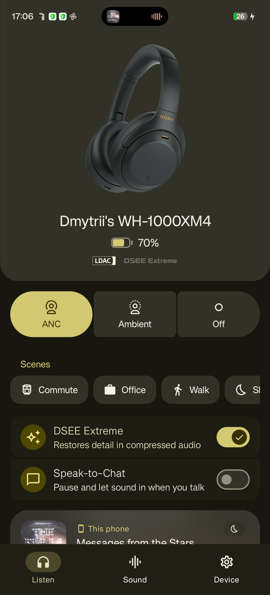
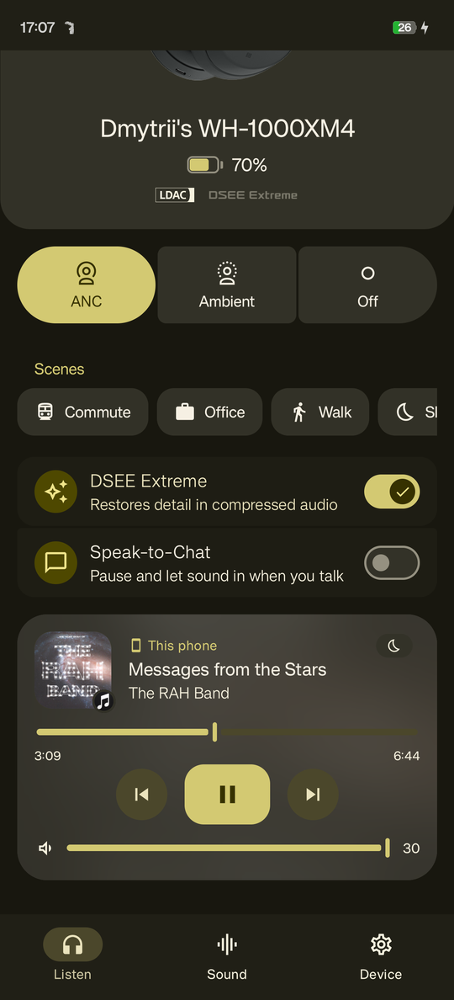
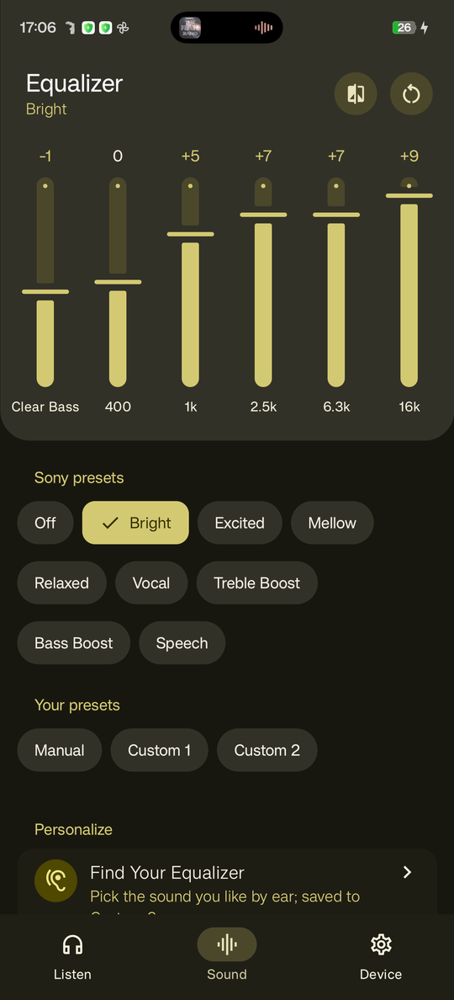
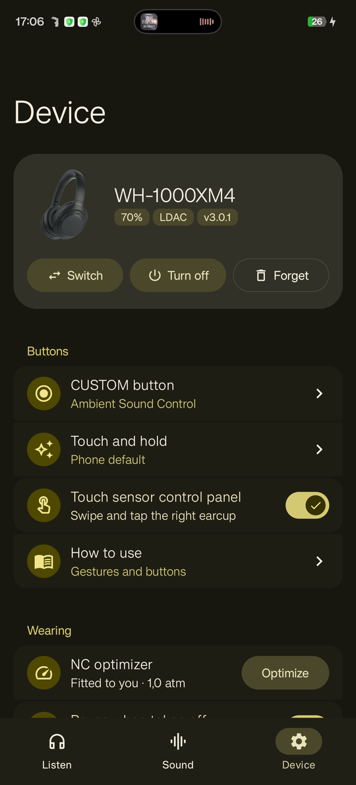
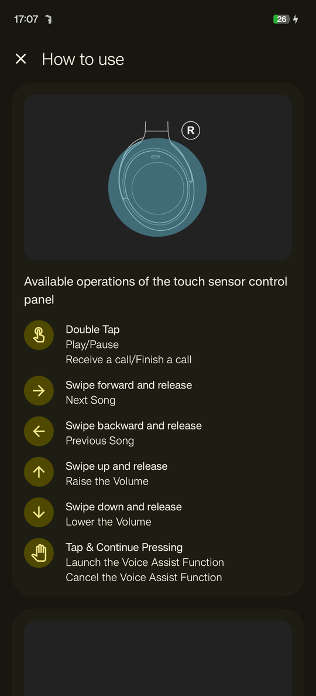
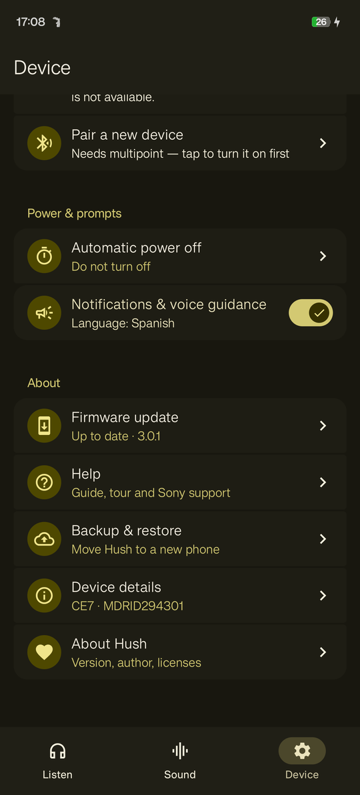
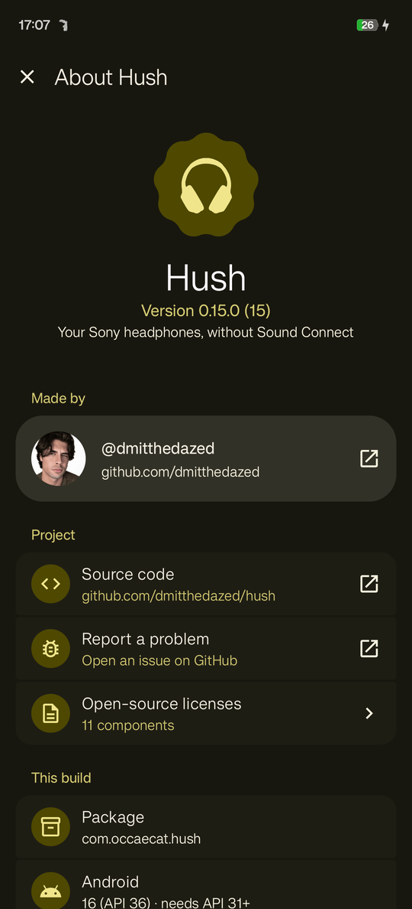

<div align="center">



# Hush

**Your Sony WH-1000XM4, without Sound Connect.**

A from-scratch Android controller that speaks Sony's headphone protocol directly — Material 3 Expressive,
no account, no analytics, and a few things Sony's own app never did.

[](https://github.com/dmitthedazed/hush/releases/latest)


[](LICENSE)






</div>

## Why

Sony's Sound Connect is heavy, logs usage analytics, and still tucks away much of what the headphones can do.
Hush reimplements the MDR protocol from the ground up (reconstructed from Sound Connect 13.3.0) and puts every setting
on three clean tabs — **Listen**, **Sound** and **Device** — in your wallpaper's colours.

## Features

### 🎧 Listen
- **Noise cancelling / Ambient / Off** with ambient level and voice focus, DSEE Extreme, Speak-to-Chat
- **Scenes** — Commute, Office, Walk, Sleep or your own: noise mode, EQ, Speak-to-Chat and volume in one tap
- **Now playing** with artwork, seek bar and the headphones' own volume; shows which device is streaming
- **Sleep timer** — fades out, pauses, then turns the headphones off (or at the end of the track)

### 🎚️ Sound
- Sony's presets plus **Manual** and **Custom 1/2**, hold-to-compare, reset
- **AutoEq** — fit published measurements (oratory1990 and others) to the 6 bands; an **EQ library** with share codes
- **Find Your Equalizer** (Sony's listening test) and a quick **hearing test**
- **Adaptive Sound Control** by activity and places, **app profiles** that switch sound per app

### ⚙️ Device
- Every Sound Connect setting: CUSTOM button, touch panel, wearing detection, NC optimizer, auto power off,
  voice guidance, multipoint and pairing a second device
- **Touch and hold** can open **ChatGPT or Claude** voice mode, switch noise modes, step through scenes, start a
  sleep timer, recognise a song, record a voice note, toggle the flashlight or fire a Tasker intent
- **Insights** — battery history and an honest time-left estimate, weekly **sound dose** (WHO 80 dB × 40 h),
  and **where you last had them**
- **Firmware check** against Sony's update server, weekly in the background
- **How to use** and a first-run **tour** from Sony's own tutorial, **Help** with Sony's support articles
- **Device details** — serial, region, service id, update method, BLE power, protocol (identifiers hidden by default)
- **Backup & restore** everything to one JSON file

### 📱 Everywhere
Home-screen widgets (Glance), a Quick Settings tile, a live notification with mode buttons, **Wear OS** app and tiles,
**Android TV**, foldable and tablet layouts — plus an optional Xposed module for deep **ColorOS** integration
(My Devices card, Bluetooth-settings switches, Fluid Cloud).

<p align="center">



</p>

## Install

1. Download `hush-<version>-phone.apk` from the [latest release](https://github.com/dmitthedazed/hush/releases/latest)
   (`-wear` for the watch, `-tv` for Android TV).
2. Pair the headphones in Android's Bluetooth settings, open Hush and pick them.
3. Close Sony Sound Connect — the headphones give their control channel to one app at a time.

Builds are signed with a development key, so Android shows an "unknown developer" prompt; updates install in place.

## Build

```bash
JAVA_HOME=/path/to/jdk-21 ./gradlew :app:assembleRelease   # also :wear and :tv
```

AGP 9, Kotlin 2.3, Compose BOM 2026.03, Material 3 1.5 (expressive). Minimum Android 12 (API 31).

## How it works

Hush opens the headphones' RFCOMM control channel and speaks Sony's MDR v1 protocol (frames, ACKs, command tables 1
and 2). Sony's cloud features are reached the way Sound Connect reaches them: the Concierge service for tutorials and
help, the model catalogue for per-colour renders, and `info.update.sony.net` for firmware. Everything is documented,
with pointers into the decompiled app, in **[docs/NOTES.md](docs/NOTES.md)**.

Tested on a WH-1000XM4 (firmware 3.0.1) with a realme phone on ColorOS 16. Other Sony models that use the same protocol
may work partly.

## Disclaimer

Hush is an independent project and is not affiliated with, endorsed or supported by Sony. Sony, WH-1000XM4,
Sound Connect, DSEE Extreme and LDAC are trademarks of Sony Group Corporation. Product images, tutorials, help articles
and firmware information belong to Sony and are fetched from Sony's servers for use with headphones you own.

## License

[MIT](LICENSE) © dmitthedazed. Third-party components and their licenses are listed in the app under
**Device → About Hush → Open-source licenses**.
