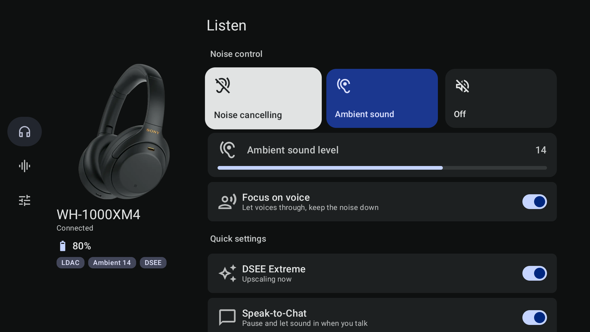
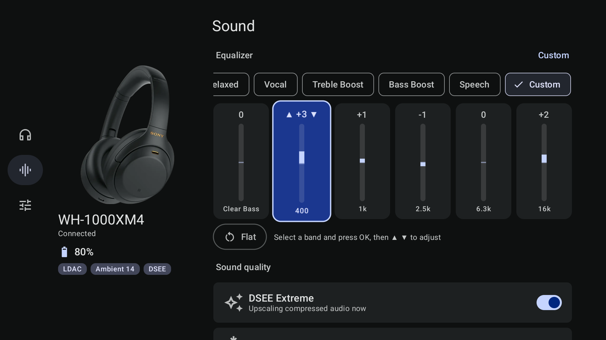
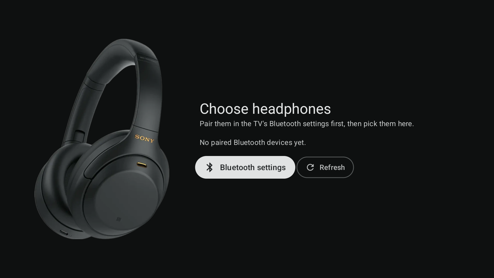

<div align="center">


# Hush

**Your Sony WH-1000XM4, without Sound Connect.**

An Android controller that talks to the headphones directly. No account, no analytics, and a few things Sony's app never did.

[](https://github.com/dmitthedazed/hush/releases/latest)


[](LICENSE)

**[Download](https://github.com/dmitthedazed/hush/releases/latest)**


</div>

## Why

Sound Connect is heavy, logs usage analytics and still hides a lot of what the headphones can do. Hush reimplements Sony's protocol from scratch and puts every setting on three tabs, **Listen**, **Sound** and **Device**, in your wallpaper's colours.

## Listen

- Noise cancelling, ambient or off, with ambient level, voice focus, DSEE Extreme and Speak-to-Chat
- **Scenes** like Commute, Office, Walk and Sleep, or your own: noise mode, EQ, Speak-to-Chat and volume in one tap. Tap again to go back.
- **Now playing** with artwork, seek bar and the headphones' own volume
- **Sleep timer** that fades out, pauses and turns the headphones off

## Sound

- Sony's presets, Manual and Custom 1/2, hold to compare
- **AutoEq**: fit published measurements (oratory1990 and others) to the six bands, and keep them in an EQ library with share codes
- **Find Your Equalizer** (Sony's listening test) and a quick hearing test
- **Adaptive Sound Control** by activity and place, and per-app sound profiles

## Device

- Every Sound Connect setting: CUSTOM button, touch panel, wearing detection, NC optimizer, auto power off, voice guidance, multipoint
- **Touch and hold** can open ChatGPT or Claude voice mode, switch noise modes, step through scenes, start a sleep timer, recognise a song, record a voice note, toggle the flashlight or fire a Tasker intent
- **Insights**: battery history with an honest time-left estimate, weekly sound dose (WHO 80 dB × 40 h), and where you last had them
- **Updates** for Hush itself and for the headphones' firmware, checked weekly
- How-to guide, first-run tour and help articles from Sony
- Backup and restore everything to one JSON file

<p align="center">
  
  
  
</p>

## Everywhere

Home-screen widgets, a Quick Settings tile, a live notification with mode buttons, a **Wear OS** app with tiles, **Android TV**, and layouts for foldables and tablets. On ColorOS, an optional Xposed module adds Hush to My Devices, the Bluetooth settings and Fluid Cloud.

<p align="center">
  
  
  
</p>

## Install

1. Download `hush-<version>-phone.apk` from the [latest release](https://github.com/dmitthedazed/hush/releases/latest). Use `-wear` for the watch and `-tv` for Android TV.
2. Pair the headphones in Android's Bluetooth settings, open Hush and pick them.
3. Close Sony Sound Connect. The headphones talk to one app at a time.

Builds are signed with a development key, so Android asks once about an unknown developer. After that Hush updates itself from GitHub releases (Device → About → Updates).

> [!NOTE]
> Tested on a WH-1000XM4 (firmware 3.0.1) with a realme phone on ColorOS 16. Other Sony models with the same protocol may partly work.

<details>
<summary>How it works</summary>

Hush opens the headphones' RFCOMM control channel and speaks Sony's MDR v1 protocol: frames, ACKs, command tables 1 and 2. Sony's cloud features are reached the way Sound Connect reaches them: the Concierge service for tutorials and help, the model catalogue for per-colour renders, and `info.update.sony.net` for firmware.

All of it is written up, with pointers into the decompiled Sound Connect 13.3.0, in [docs/NOTES.md](docs/NOTES.md).

</details>

<details>
<summary>Build</summary>

Needs JDK 21. Minimum Android 12 (API 31).

```sh
./gradlew :app:assembleRelease    # phone; also :wear and :tv
./gradlew testDebugUnitTest
```

See [CONTRIBUTING.md](CONTRIBUTING.md).

</details>

## Disclaimer

Hush is an independent project, not affiliated with or endorsed by Sony. Sony, WH-1000XM4, Sound Connect, DSEE Extreme and LDAC are trademarks of Sony Group Corporation. Product images, tutorials, help articles and firmware information belong to Sony and are fetched from Sony's servers for use with headphones you own.

## License

[MIT](LICENSE) © dmitthedazed. Third-party licenses are listed in the app under Device → About Hush → Open-source licenses.
